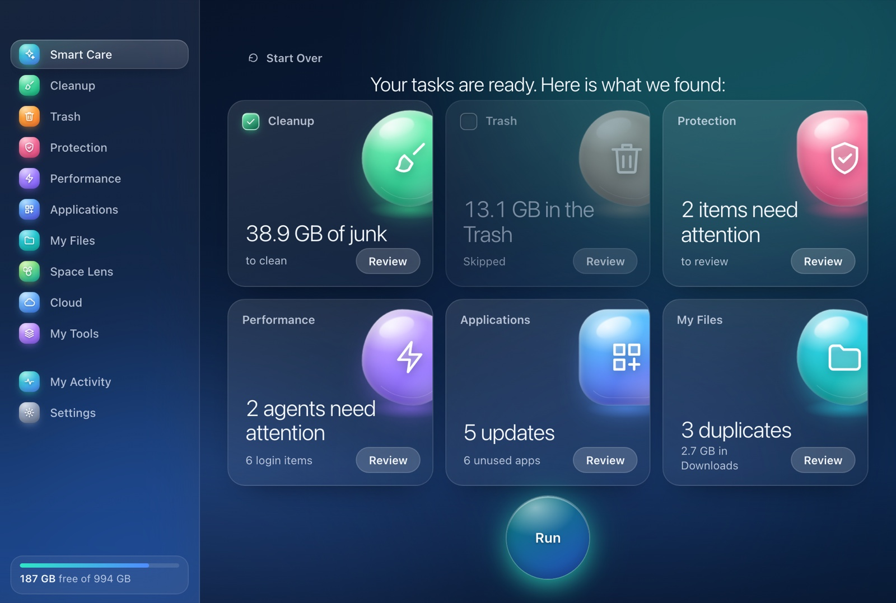
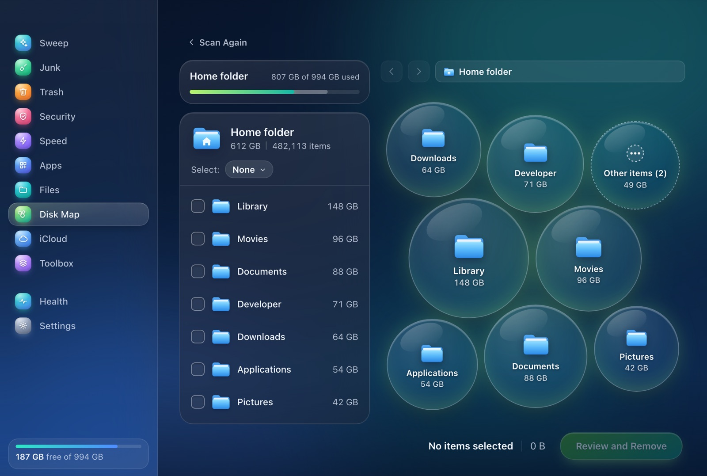
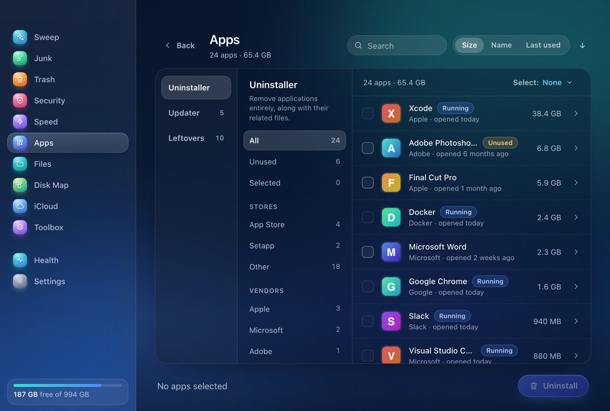
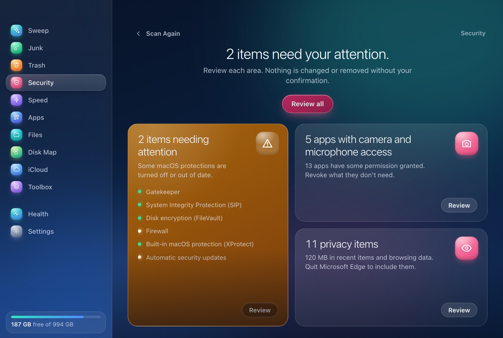

<div align="center">


# Limpae

**A small, fast and careful disk cleaner for macOS.**<br>
Native Rust engine, system WebKit, a hand-built interface. About 7 MB on disk.


</div>

---

Limpae finds what is safe to remove, shows you exactly what it found, and only then removes it. It is built around one rule: **a deletion has to be provably safe before it is fast.**

No antivirus and no telemetry. Limpae makes no network requests of its own; everything runs on your Mac.

<div align="center">

 
 

<sub>Screenshots use sample data.</sub>

</div>

> **Status: early.** Limpae removes files from your disk. It is built to be careful (see the [safety model](#safety-model)) and the engine has an extensive test suite, but it is young software: review what it selects, keep backups, and use it at your own risk. Releases are not published yet; build it from source.

## Highlights

- **Sweep.** One scan across six modules, one pre-selected review, one button. Only safe junk is pre-selected; your own files never are.
- **Disk Map.** An interactive bubble map of what is using your disk, with Finder-style navigation, Quick Look and reveal-in-Finder.
- **Junk.** User caches and logs, Xcode and package-manager caches, AI tool leftovers, broken preferences and login items, iOS backups, Mail attachments, and Trash bins on external volumes.
- **App manager.** Uninstall apps together with the leftovers in `~/Library`, find orphaned leftovers, installers, unused apps and available updates.
- **Files.** Large and old files, exact duplicates, similar images (best copy pre-marked) and a per-app view of Downloads.
- **Security, without an antivirus.** Security posture checks (Gatekeeper, SIP, FileVault, firewall, XProtect age, updates), app permissions you can review and revoke, and privacy traces.
- **Speed.** Background agents and login items with code-signature checks, a live system monitor and Time Machine snapshot thinning.
- **Menu bar extra.** Health, free space, memory pressure and Trash size at a glance, as a native menu that costs nothing while closed.
- **Calm by default.** Elegant motion that pauses when the window is idle, glass-like synthesized sounds (no audio files) and Esc / ⌘[ to go back.
- **Three languages.** English (default), Brazilian Portuguese and Bahasa Indonesia, switchable in Settings.

## Modules

| Module | What it does |
| --- | --- |
| **Sweep** | Scans Junk, Trash, Security, Speed, Apps and Files in one pass and removes the pre-selected junk. |
| **Junk** | System and app junk, grouped and sized, with per-item review. |
| **Trash** | Shows what is in every Trash (including external volumes) and empties it with confirmation. |
| **Security** | Security posture, app permissions (TCC) and privacy traces. Read-only checks; fixes open the right Settings pane. |
| **Speed** | Background agents, login items, live monitor, snapshots. |
| **Apps** | Uninstaller, updater, leftovers, installers, vendor view. |
| **Files** | Large and old files, duplicates, similar images, Downloads. |
| **Disk Map** | Visual map of what uses your disk. |
| **iCloud** | Evict local copies of files that are already in iCloud. |
| **Toolbox** | Every tool in one place, with favorites and a screen cleaning mode. |
| **Health** | Mac health score with recommendations. |

## Safety model

Deleting files is the dangerous part of a cleaner, so the engine is conservative and checks again at the last moment.

- **The UI never sends file paths.** The backend keeps the result of every scan and hands out numeric ids that are never reused. To remove something, the UI returns ids.
- **Everything goes through the `Guard` again at removal time** (`crates/limpa-core/src/guard.rs`). It requires an absolute path without `..`, strictly inside the root allowed for the item's policy; refuses anything that is, or contains, a protected location (`/`, `~`, `~/Library`, `~/Documents`, …); never touches `~/.ssh`, Keychains, iCloud Drive, Mail, Messages or Photos; and never follows symlinks.
- **Identity is verified.** Each item's device and inode are recorded at scan time. If the path now points to a different file, removal is refused.
- **Recoverable by default.** Regenerable caches and logs are deleted directly, since moving them to the Trash would free nothing. User files, apps and leftovers go to the Trash through `NSFileManager`. Permanent deletion is an explicit choice, off by default, and every confirmation still lets you decide.
- **Open apps are protected.** A running app is recognized by bundle id, name and vendor folders (for example `Caches/Google` for Chrome). Its cache starts unselected, and if the app opens after the scan, removing that cache is refused.
- **Leftovers need proof of ownership**, re-verified at removal. If another copy of the same app is installed, leftovers start unselected.
- **Never listed:** in-progress downloads, App Store and macOS update caches, and iCloud, HomeKit and Find My services.
- **Expensive-to-rebuild caches start unselected.** User files are never pre-selected.
- **Everything is logged** to `~/Library/Logs/Limpae/actions.log`, one line per action.

### Left out on purpose

- Language and universal-binary stripping, because it breaks code signatures.
- System caches, because they need root.
- "Antimalware" without a signature database.
- `~/Library/Containers` in Junk, because it triggers privacy alerts.

## Install

Requires macOS 13 or later, Rust (stable) and [`tauri-cli`](https://tauri.app) 2.

```sh
cargo install tauri-cli --version '^2' --locked   # once
scripts/install.sh
```

The script builds a release bundle, copies it to `~/Applications/Limpae.app`, registers it with LaunchServices and waits until Spotlight indexes it, so Limpae shows up in Spotlight and Launchpad. The bundle is signed ad hoc, not with a Developer ID, and is not notarized: build it yourself instead of downloading a binary someone else built.

### Permissions

Limpae works without any special permission, but it cannot read the Trash or part of `~/Library` until you grant **Full Disk Access** (System Settings › Privacy & Security › Full Disk Access). The local build is ad-hoc signed, so macOS ties the grant to the binary hash: after rebuilding you have to grant it again.

To keep the grant across rebuilds, create a self-signed code-signing certificate once: Keychain Access › Certificate Assistant › Create a Certificate, name **Limpae Local**, identity type *Self Signed Root*, certificate type *Code Signing*. `scripts/install.sh` finds it and re-signs the bundle with it (set `LIMPAE_SIGN_IDENTITY` to use another name). Grant Full Disk Access once more after the first signed install.

Removing system-installed apps asks Finder to move them, which prompts for your administrator password. Listing login items uses System Events. Both prompts are localized.

### Building a release

`scripts/release.sh` builds `dist/Limpae-<version>.dmg` and its SHA-256. Without credentials the app inside is signed ad hoc, which only opens on the Mac that built it. With a Developer ID it signs with the hardened runtime, notarizes, staples and checks the result with Gatekeeper:

```sh
xcrun notarytool store-credentials limpae-notary --apple-id <apple-id> --team-id <TEAMID>   # once
LIMPAE_DEVELOPER_ID="Developer ID Application: Your Name (TEAMID)" \
LIMPAE_NOTARY_PROFILE=limpae-notary scripts/release.sh
```

Pushing a `v*` tag runs the same script in GitHub Actions (`.github/workflows/release.yml`). It drafts a GitHub Release only when the signing secrets are configured; otherwise the DMG is kept as a workflow artifact and nothing is published.

## Languages

Pick the language in **Settings › General**. English is the default.

| Language | Code |
| --- | --- |
| English | `en` |
| Português (Brasil) | `pt` |
| Bahasa Indonesia | `id` |

The key of every UI string is its Portuguese source text, so Portuguese needs no dictionary. English and Indonesian live in `ui/js/i18n/dict/`, one file per area, as `{ en, id }` per key. Texts that the Rust backend returns in Portuguese go through `tr()`, which also matches `{param}` patterns. The menu bar extra and the system permission prompt are localized natively.

To check that nothing is missing or untranslated:

```sh
node scripts/check-i18n.mjs            # whole UI
node scripts/check-i18n.mjs ui/js/views/apps.js
```

It reports missing translations, dynamic keys, mismatched `{placeholders}` and Portuguese literals left outside `t()`. Adding a language means adding it to `LANGS` in `ui/js/i18n.js`, a value per key in the dictionaries, and a `.lproj` folder in `src-tauri/locales`.

### Contributing a translation

Copy the shape of an existing entry in `ui/js/i18n/dict/*.js`, run `node scripts/check-i18n.mjs`, and look at the screen in your language: longer words are the usual cause of clipped labels. New languages also need a `.lproj` folder in `src-tauri/locales` and an entry in `LANGS` in `ui/js/i18n.js`.

## Architecture

```
crates/limpa-core/   Rust engine: scanning, Guard, removal, health, security, performance. No UI, no Tauri.
src-tauri/           Tauri 2 shell: commands, scan registry, menu bar extra. Uses the system WebKit.
ui/                  The interface in plain HTML, CSS and ES modules. No framework, no bundler, no npm.
scripts/             install.sh, check-i18n.mjs
docs/screenshots/    Images used by this README.
```

Design choices that follow from "light and fast":

- The engine is a library with its own tests; the shell only adapts it to Tauri commands that run on the blocking pool.
- Directory walks stat sequentially per directory and parallelize across subdirectories.
- The UI has no runtime dependencies and builds DOM with `createElement`/`textContent` only, because file names come from the disk and are not trusted.
- Continuous animations pause when the window is not focused, so the app is idle in the background. Reduced-motion preferences are honored.
- Sounds are synthesized with WebAudio at play time; there are no audio assets.

## Development

```sh
cargo test --workspace
cargo clippy --workspace --all-targets -- -D warnings
node scripts/check-i18n.mjs
(cd tests/ui && npm install && npx playwright install webkit && npx playwright test)   # UI end-to-end, mocked backend
cargo run -p limpae            # runs the app serving ./ui
```

The `ui/` folder is served as is, so UI changes need no build step; reload the window.

## Credits and license

Branding, artwork and sounds are original to Limpae.

Released into the public domain under [The Unlicense](LICENSE): use, copy, modify and redistribute it for any purpose, with or without credit.
